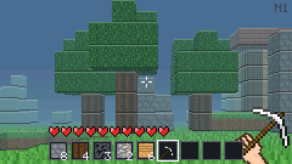
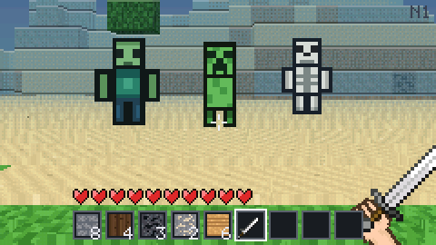
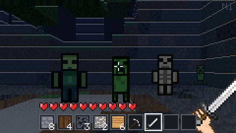
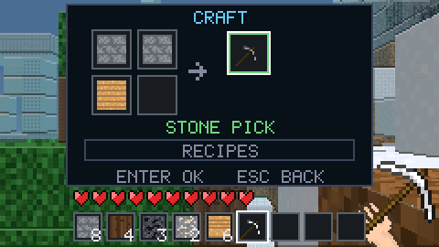
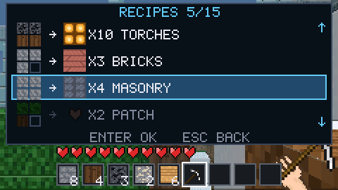
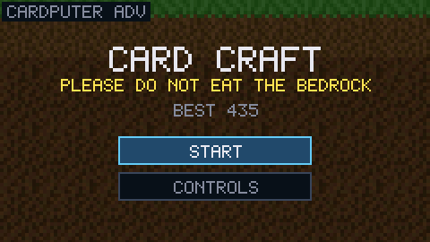

<h1 align="center">Card Craft</h1>

<p align="center"><b>Mine by day. Wall yourself in by night. Survive.</b></p>

<p align="center">
  
  
</p>

<p align="center"></p>

A first-person survival game that runs on the thing in your pocket. Dig up a
world made of blocks, build something to hide in, and see how many nights you
last.

> **Card Craft Plus** is a fork of [therezor/card-craft](https://github.com/therezor/card-craft)
> (MIT, upstream snapshot `2cf7513`, 1.0.1) with the additions listed
> [below](#card-craft-plus-what-this-fork-adds). The game is REZOR's; the
> additions here are the fork's.

## Card Craft Plus: what this fork adds

Everything upstream has, plus:

- **Three save slots on the SD card.** `SAVE GAME` / `LOAD GAME` with night, day
  phase, position, inventory, the whole world and the crafting grid. Saves are
  CRC-checked, written through a zeroed header so a power cut mid-write reads as
  `EMPTY` rather than as a corrupt world, and the card is re-mounted on each open
  so a card put in after boot is found. See [`SAVES.md`](SAVES.md).
- **A settings card.** Brightness, field of view (60–90°, no distortion), and the
  gyroscope: on/off, three sensitivities, calibration, and which measured axis
  each half of the look control uses. All of it persists in NVS. See
  [`SETTINGS.md`](SETTINGS.md).
- **Tilt to look on the Cardputer ADV.** The BMI270 drives yaw and pitch
  alongside the keys, through the fixed-timestep simulation rather than the frame
  loop, so the whole path is covered by host tests. The axis mapping is a setting
  because the first board answered "which axis is which" the hard way.
- **An emulator harness.** `pio run -e adv-tour` builds a shot list into the
  firmware, and `tools/capture-tour.py` drives it against the
  [m5stack-esp-emulator](https://github.com/m5agent/m5stack-esp-emulator) Device
  Service, writing `docs/emu/`. That is how the settings card's screenshots and
  the save-card write were verified without a hand on the device.
- **Host tests** for the parts with no hardware in them: the world grid, the
  raycaster, the survival simulation, the settings arithmetic, the gyro mapping,
  and the save layer against real files.

## What you do

**Mine.** Every block can come out, and every block goes back somewhere else.
Dig into a hillside and the rest of it stays up. Cut a tunnel, lay a floor in
mid-air, take the roof off a ruin.

**Build.** Two blocks high is over your head, so a wall is a wall. That is the
whole plan for most of your first night.

**Craft.** Recipes are shapes. A pickaxe is a wide head over a handle, a sword
is a blade over a handle, a torch is coal over wood. Start with nothing, chop a
tree, and work up through stone, iron and diamond.

**Survive.** At dusk the mobs come. Zombies wind up before they swing, so you
can see it and step back. Skeletons shoot from far away. Creepers blow a hole
in whatever you just built. Torches keep the ground around them clear.

Your score is nights survived. It is saved on the device.

<p align="center">
  
  
</p>
<p align="center"><i>A sword answers them in daylight. At night you mostly hear them first.</i></p>

<p align="center">
  
  
</p>
<p align="center"><i>Lay a recipe out yourself, or pick it from the book.</i></p>

<p align="center"></p>

## Controls

Right hand moves, left hand acts.

| | Key |
|---|---|
| Move, turn | arrows |
| Mine, attack | `W` — hold it |
| Build | `A` |
| Look up, down | `E` `S` |
| Centre the view | `ENTER` |
| Jump | `SPACE` |
| Pick a block | `1`–`9` |
| Drop | `Q` |
| Craft | `TAB` |
| Confirm, back | `ENTER`, `ESC` |

There is a **CONTROLS** card in the game as well, on the title screen and in
the pause menu, and a **SETTINGS** card behind it: brightness, field of view, and
— on the Cardputer ADV — tilt-to-look with the built-in gyroscope. See
[`SETTINGS.md`](SETTINGS.md).

## Install

You need a [M5Stack Cardputer](https://shop.m5stack.com/products/m5stack-cardputer-kit-w-m5stamps3)
and [PlatformIO](https://platformio.org/install).

```sh
git clone https://github.com/therezor/card-craft
cd card-craft
pio run -e cardputer -t upload
```

One build runs on both the Cardputer and the Cardputer ADV.

### Building this fork

The fork's own env is `adv` (ESP32-S3, Arduino core 2.0.16), because that is what
has been run on a Cardputer ADV here. Upstream's `cardputer` env still exists and
still builds the same game for the original Cardputer.

Four M5Stack libraries are **symlinked into `lib/` instead of named in
`lib_deps`**, and the versions are pinned:

```sh
# once, with the four libraries already present in a PlatformIO libdeps tree:
tools/link-local-libs.sh ~/.platformio/libdeps/cardputer-adv

pio run -e adv            # the firmware
pio test -e native        # 222 host tests, no board needed
bash test/host_sd/run.sh  # the save layer against real files, 52 assertions
```

`lib_deps` cannot be used for this: Library Dependency Finder resolves a declared
dependency (`M5Unified` wants `M5GFX >= 0.3.0`) from the registry even when an
explicit entry of the same name is listed, and **0.3.0 gives a black panel on
this board** — `M5Cardputer` 1.1.1's keyboard reports `Unsupported board type:
136` instead of `board_M5CardputerADV`. 0.2.36 / 0.2.29 boots straight to the
title card. `tools/link-local-libs.sh` pins exactly those.

`pio run -e adv-tour` builds the emulator-only variant (a shot list plus a fake
gyro, `-DCRAFTCRAFT_EMU_TOUR -DCRAFTCRAFT_GYRO_FAKE`); it is not for flashing to
a device you plan to use.

<p align="center">MIT · made by <b>REZOR</b> · <a href="https://rezor.me">rezor.me</a></p>
